# CSPC - Computer Science for Physics and Chemistry

## Setup

Create the environment for PW1 - Lab A:

```bash
conda env create -f PW1/Lab\ A/environment.yml
conda activate cspc
```

## PW1 - Lab A: Reproducible Foundations

**What I did:**
- Set up a reproducible Python environment using Conda and created a Git repository.
- Worked with a radioactive decay simulation and added automated tests using `pytest`.
- Compared pure Python and NumPy implementations.

**Performance comparison:**

| Implementation | Execution time |
|---|---:|
| Python loop | 4.30854502 s |
| NumPy | 0.00022917 s |
| Speed-up | 18,800.73x |

**Tests:** 3/3 passed.

**Conclusion:**

I learned the basics of Python environments, Git, automated testing, and NumPy. I also solved problems with the environment, file locations, Git setup, and test parameters. AI helped me understand errors and work through some setup and testing steps.

## PW1 - Lab B: Radioactive Decay

The observed count decreased over time and followed the general exponential decay pattern described by \(N(t)=N_0e^{-\lambda t}\), with \(\lambda=0.3\).

The Snakemake pipeline runs `plot.py` to generate `figure.png` from `decay_observed.csv` and reruns the step when its inputs change.


## PW2 - Lab A: Numerical Differentiation and Integration

**Objective:** Analyse free-fall position data using numerical differentiation and integration.

Velocity and acceleration were calculated using `np.gradient()`.

| Measurement | Result |
|---|---:|
| Mean acceleration | -8.58 m/s² |
| Expected acceleration | -9.81 m/s² |
| Maximum position difference after integration | 0.785 m |

Differentiation, especially taking two derivatives, amplified measurement noise in the acceleration. Integrating the results back to position gave a maximum difference of 0.785 m.

**Output:** `motion.png`, showing position, velocity, and acceleration over time.


## PW2 - Lab B: Numerical Methods

### Part 2 - Three Routes to a Minimum

I compared gradient descent, Newton's method, and SLSQP.

**2A - Convex function**

For \(f(x)=(x-3)^2+1\), starting from \(x_0=0\):

| Method | Minimum location |
|---|---:|
| Gradient descent | 3.0000 |
| Newton | 3.0000 |
| SLSQP | 3.0000 |

All three methods found the global minimum.

**2B - More complex function**

For \(g(x)=x^4-3x^2+x+5\):

| Starting point | Gradient descent | Newton | SLSQP |
|---|---:|---:|---:|
| \(x_0=0\) | -1.30084 | 0.16994 (maximum) | -1.30086 |
| \(x_0=2\) | -1.30084 | 1.13090 (minimum) | -1.30064 |

Newton's method reached different stationary points depending on the starting point, while gradient descent and SLSQP found the minimum near \(x=-1.30\).

### Part 3 - Reaction Rate

I fitted the first-order model \(C(t)=C_0e^{-kt}\) to the measured data using SLSQP with \(0\leq k\leq5\).

**Fitted rate constant:** \(k=0.26176137\)

**Output:** `kinetics.png`


### Part 4 - Chemical Equilibrium

For the reaction \(H_2+I_2\rightleftharpoons2HI\), with \(K=15.6\):

| Method | Equilibrium extent |
|---|---:|
| Newton | 0.66384767 |
| SLSQP | 0.66384743 |

**Equilibrium amounts:**

| Substance | Amount |
|---|---:|
| H₂ | 0.33615 mol |
| I₂ | 0.33615 mol |
| HI | 1.32770 mol |

Both methods gave nearly identical results.


### Part 5 - Titration

I calculated the pH slope using `np.gradient(pH, V)` and located its maximum.

**Equivalence point:** 50.0 mL


## PW3 - Statistical Analysis of Scientific Data

### Session 1 - Heart Disease Dataset

**Dataset:** `heart.csv` - 303 rows and 14 columns.

I used pandas to inspect the data and plotted the distributions of `age`, `chol`, `trestbps`, and `thalach`.

**Output:** `distributions.png`

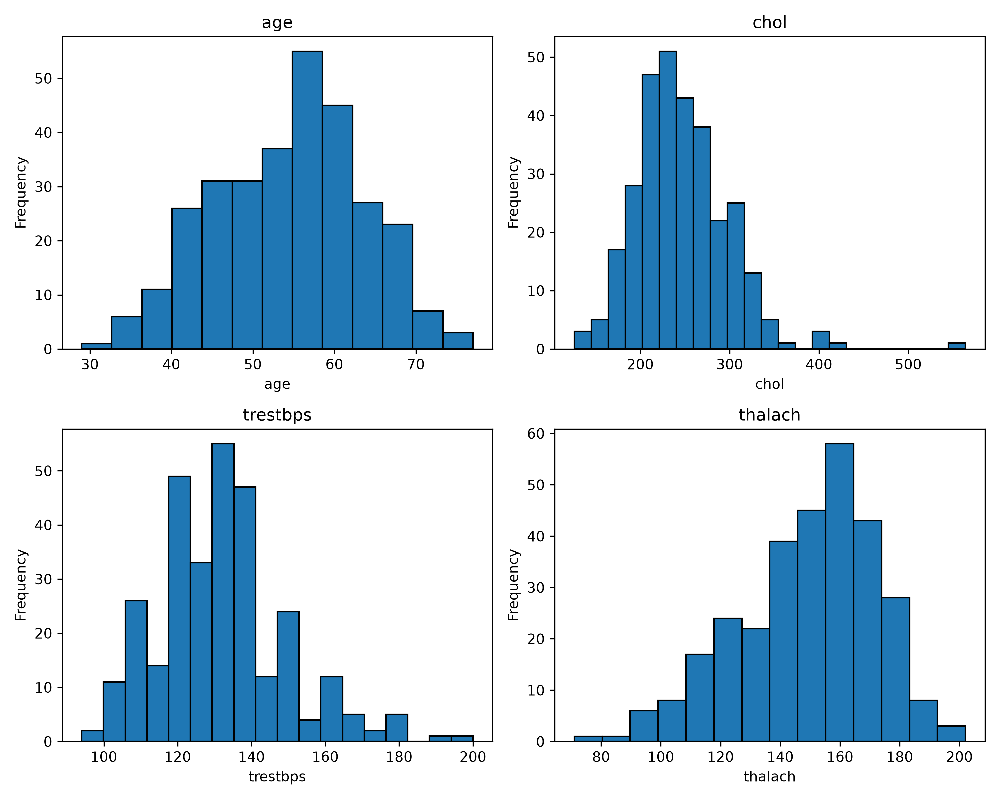

**Normality tests**

I used the Shapiro-Wilk test with a significance level of 0.05.

| Variable | W statistic | p-value | Verdict |
|---|---:|---:|---|
| `age` | 0.9865 | 0.006069 | Non-normal |
| `chol` | 0.9473 | 5.912 x 10⁻⁹ | Non-normal |
| `trestbps` | 0.9665 | 1.802 x 10⁻⁶ | Non-normal |
| `thalach` | 0.9765 | 6.996 x 10⁻⁵ | Non-normal |

All p-values were below 0.05, providing evidence against normality.

### Session 2 - Heart Rate and Age

**Maximum heart rate**

I compared healthy patients (`target = 0`) with patients with heart disease (`target = 1`) using the Mann-Whitney U test because the normality tests indicated non-normal data.

| Group | Mean `thalach` | 95% confidence interval |
|---|---:|---:|
| Healthy | 158.38 | 155.42-161.34 |
| Heart disease | 139.26 | 135.47-143.05 |

**U = 5806.5, p = 1.861 x 10⁻¹³**

The difference was statistically significant. The heart-disease group had a mean maximum heart rate about 19.12 beats/min lower.

**Output:** `thalach_comparison.png`

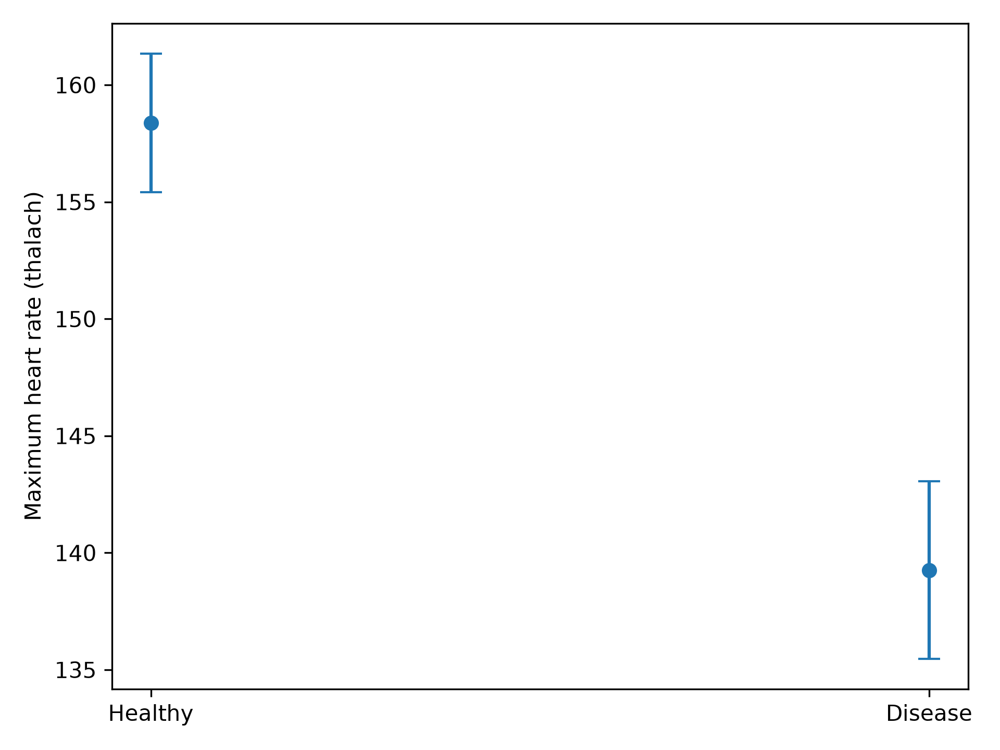

**Age and maximum heart rate**

I used Pearson's correlation to measure their linear relationship.

| Correlation | p-value | Conclusion |
|---:|---:|---|
| -0.394 | 1.109 x 10⁻¹² | Moderate negative relationship |

Older patients tended to have lower maximum heart rates.

**Output:** `age_thalach.png`

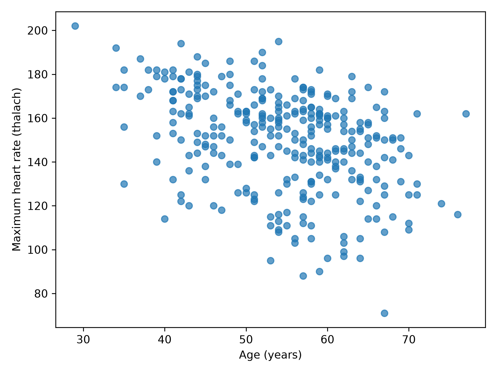

### Chemical Exposure and Malignancy

**Dataset:** `chemicals cancer.csv` - 1,000 patients.

**Initial correlations**

I calculated Pearson correlations between each chemical and malignancy without controlling for other variables.

| Chemical | Correlation | p-value |
|---|---:|---:|
| Benzene | 0.385 | 1.276 x 10⁻³⁶ |
| Cadmium | 0.880 | Extremely small |

Initially, cadmium appeared to have the stronger relationship with malignancy.

**Controlling for pollution**

I repeated the analysis for the 201 patients with a pollution index between 40 and 60.

| Chemical | Correlation | p-value |
|---|---:|---:|
| Benzene | 0.698 | 1.154 x 10⁻³⁰ |
| Cadmium | 0.313 | 5.994 x 10⁻⁶ |

Benzene's correlation became stronger, while cadmium's weakened. This suggested that pollution influenced the initial results.

**Multiple regression**

I then fitted a multiple linear regression model including benzene, cadmium, pollution index, and age. This allowed me to examine each variable while accounting for the others.

| Variable | Coefficient | p-value | Result |
|---|---:|---:|---|
| Benzene | +0.5452 | < 0.001 | Significant |
| Cadmium | -0.0677 | 0.224 | Not significant |
| Pollution index | +0.7773 | < 0.001 | Significant |
| Age | +0.1064 | < 0.001 | Significant |

**R² = 0.917** - the model explained about 91.7% of the variation in malignancy.

**Conclusion:** Cadmium initially appeared more strongly related to malignancy, but it was no longer statistically significant in the multiple regression. Benzene remained significant, making it the stronger candidate in this dataset. However, regression alone cannot prove causation; confirming the actual cause requires knowledge of how the synthetic data was generated or other causal evidence.

### Bonus - Category Unpredictability

I calculated the proportions and Shannon entropy of the heart-disease `target` column.

| Measure | Result |
|---|---:|
| Target 0 | 54.13% |
| Target 1 | 45.87% |
| Entropy | 0.995 bits |
| Maximum entropy | 1 bit |

The categories were nearly balanced, so predicting the target without additional information involved considerable uncertainty.

### PW3 Outputs

| File | Contents |
|---|---|
| `distributions.png` | Distributions of four continuous variables |
| `thalach_comparison.png` | Heart-rate group comparison |
| `age_thalach.png` | Age and maximum heart-rate relationship |

## PW4 - Machine Learning: Supervised and Unsupervised

### Session A - Concrete Compressive Strength (Supervised Learning)

**Dataset:** UCI Concrete Compressive Strength (`data/concrete.csv`) — 1,030 laboratory tests (1,005 unique rows after cleaning) with 8 inputs and 1 continuous target.

| Variable | Description | Unit |
|---|---|---|
| `cement` | Blast furnace cement | kg/m³ |
| `slag` | Blast furnace slag | kg/m³ |
| `ash` | Fly ash | kg/m³ |
| `coarse_agg` | Coarse aggregate (gravel) | kg/m³ |
| `fine_agg` | Fine aggregate (sand) | kg/m³ |
| `water` | Water | kg/m³ |
| `superplastic` | Superplasticizer additive | kg/m³ |
| `age` | Curing time | days |
| `strength` | Compressive strength (target) | MPa |

**Data Cleaning and Exploration**

I checked for missing values (0 found) and duplicate rows (25 found), then removed the duplicates before splitting. Keeping duplicate rows would cause data leakage if the same test appeared in both the training and test sets, artificially inflating test scores.

From `describe()`, aggregate features (`coarse_agg`, `fine_agg`) and `cement` operate on scales of hundreds of kg/m³, while `superplastic` and `age` have much smaller numerical ranges. Strength increased linearly with `cement`, while strength vs. `age` followed a curved, logarithmic trend with fast gains early on that flattened over time.

**Output:** `eda_plots.png`

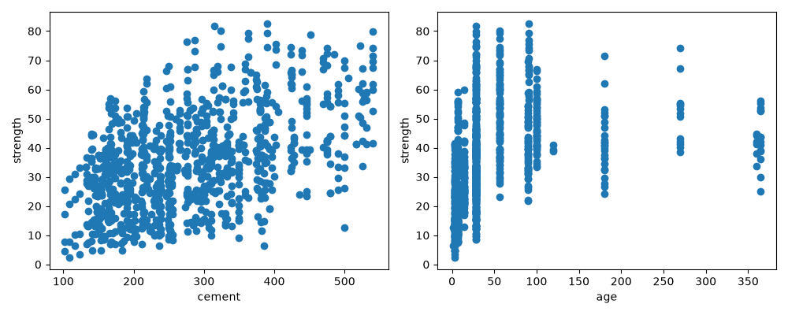

**Linear and Polynomial Regression**

I split the data (80% train, 20% test) and fitted a multiple linear regression model. Plotting test residuals against `age` on a log scale showed a systematic curved pattern, indicating that a linear model could not capture the non-linear curing behavior.

To capture non-linearity, I tested polynomial features from degree 1 to 4 inside a pipeline with `StandardScaler()`:

| Degree | Features ($p$) | Behavior |
|---:|---:|---|
| 1 | 8 | Baseline linear fit; underfits non-linear curing trends. |
| 2 | 44 | **Chosen model.** Significantly lowers test RMSE and raises test $R^2$ without overfitting. |
| 3 | 164 | Slight improvement on train, but test error begins to plateau. |
| 4 | 495 | **Severe overfitting.** Feature count approaches training row count ($n \approx 804$), causing test $R^2$ to collapse. |

Adjusted $R^2$ alone does not protect against degree 4 overfitting because it is calculated strictly on the training data.

**Output:** `residuals.png`

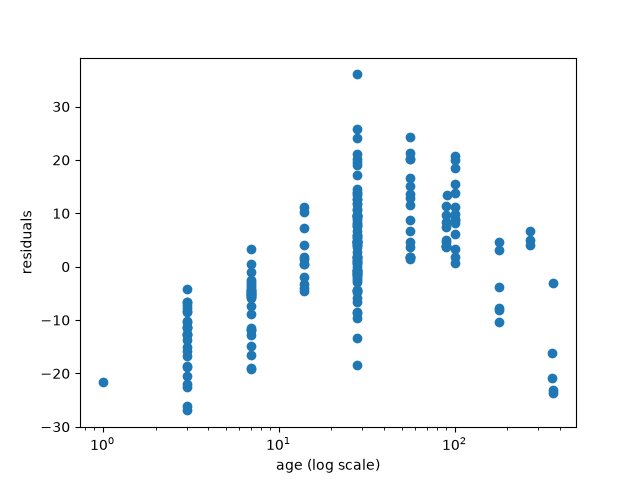

**Classification: KNN and Decision Tree**

I converted `strength` into a binary target (`1` if $\ge 40\text{ MPa}$, `0` otherwise) and used a stratified 80/20 split.

* **K-Nearest Neighbors (KNN):** Sweeping $K \in \{1, 3, 5, 7, 15, 25, 51, 101\}$ showed that $K=1$ overfitted and very large $K$ underfitted. **$K=7$** gave the best balance of test accuracy and stability. Removing `StandardScaler()` caused accuracy to drop significantly because distance calculations were dominated by large-scale aggregate columns. Testing across 5 random seeds (`0..4`) showed a narrow spread, confirming the result was stable.
* **Decision Tree:** Sweeping `max_depth` showed that an unlimited tree (`None`) reached 100% training accuracy while test accuracy dropped due to overfitting. **`max_depth = 4`** was chosen because it achieved near-peak test accuracy while remaining easy to read. The root split divided mixes based on `age` or `cement`, which aligns with physical hydration rules.

**Outputs:** `knn_acc.png`, `tree_acc.png`

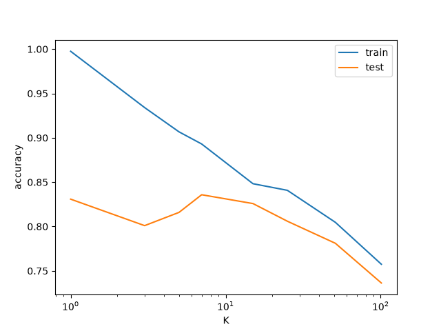
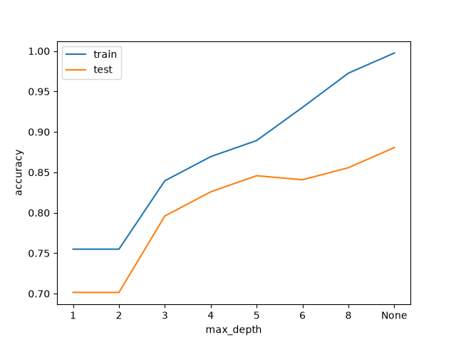

**Metrics and Safety Thresholds**

On a construction site, a **False Positive (FP)**—predicting a batch reaches 40 MPa when it actually does not—is the dangerous mistake because it risks structural failure. **Precision** directly controls False Positives.

Sweeping probability thresholds ($0.3, 0.5, 0.7, 0.9$) showed that raising the threshold to **0.7 or 0.9** pushed False Positives near zero and maximized Precision. The cost of a safer threshold is higher False Negatives (FN), meaning safe concrete batches get rejected, increasing material waste.

**Output:** `A_metrics.csv`

**Feature Importance and Physics Bonus**

Raw regression coefficients cannot be compared directly because they carry different units ($\text{MPa per kg/m}^3$ vs. $\text{MPa per day}$). Standardized coefficients, decision tree importances, and permutation importances all agreed that `age`, `cement`, and `water` were the strongest predictors. This matches concrete engineering principles (hydration time and water-to-cement ratio), though high statistical importance alone does not prove physical causation without controlled experiments.

In the bonus step, replacing raw inputs with two domain-engineered features—$\log(\text{age})$ and the water-to-binder ratio $w/b = \text{water} / (\text{cement} + \text{slag} + \text{ash})$—achieved strong test $R^2$ using only 2 features, showing that physical domain knowledge outperforms blind polynomial expansion.

**Output:** `feature_importance.png`

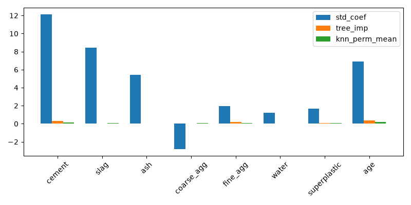

---

### Session B - Wine Chemistry (Unsupervised Learning)

**Dataset:** UCI Wine dataset — 178 Italian wines across 3 grape cultivars, described by 13 chemical measurements. Cultivar labels were hidden until the final evaluation.

**PCA: Raw vs. Scaled Data**

From `describe()`, `proline` and `magnesium` had the largest numerical ranges and standard deviations, while `nonflavanoid_phenols` and `hue` had the smallest.

* **Raw PCA:** Running PCA without scaling caused PC1 to capture over 99% of total variance, almost entirely driven by `proline`. This did not reflect true chemical differences—only differences in measurement scale.
* **Scaled PCA:** Applying `StandardScaler()` first put all 13 chemicals on equal footing. **8 principal components** were needed to capture 90% of the cumulative variance, while the PC1–PC2 plane captured about 55%. PC1 separated wines by phenol, flavonoid, and color intensity levels, while PC2 separated wines by alcohol, ash, and acid content.

**Outputs:** `scree_plot.png`, `pca_unlabeled.png`

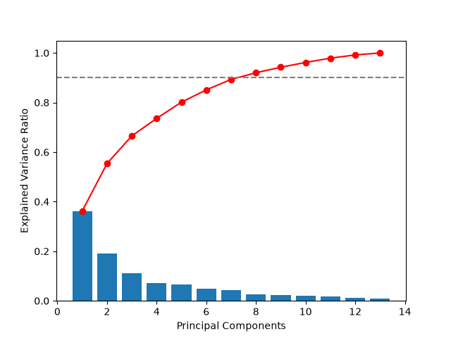

**K-Means Clustering**

Running K-Means with `n_init=1` across seeds `0..7` produced different inertia values because random starting centroids can get trapped in local minima. Using `n_init=10` ran 10 initializations and kept the lowest inertia solution.

Plotting inertia for $k = 1 \dots 10$ showed a clear elbow at **$k = 3$**. Choosing $k$ simply by minimizing inertia is invalid because inertia drops to 0 when $k = n$ (every point in its own cluster).

Converting the $k=3$ cluster centers back to real units revealed three distinct chemical profiles:
* **Cluster 0:** High flavonoids and total phenols with moderate alcohol.
* **Cluster 1:** High alcohol, high proline, and deep color intensity.
* **Cluster 2:** High malic acid and non-flavonoid phenols with low total phenols and lower alcohol.

**Outputs:** `kmeans_elbow.png`, `pca_clusters.png`

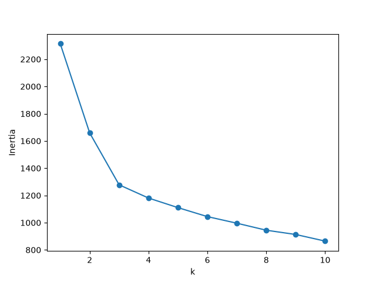
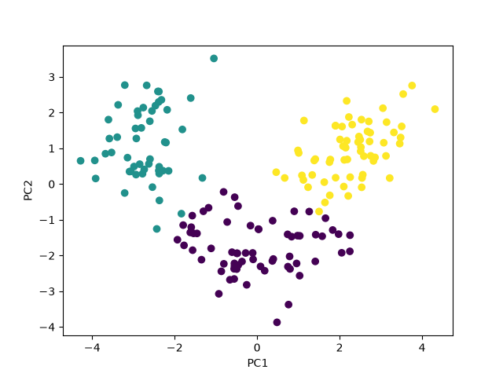

**Comparison with True Cultivars**

Comparing K-Means clusters ($k=3$) against the hidden cultivar labels using a crosstab gave the following majority-matching agreement scores:

| Feature Space | Agreement Score | Explanation |
|---|---:|---|
| Scaled Data (13 features) | Highest (~96.6%) | All chemical features contribute equally. |
| Top 2 PCs (Scaled) | Slightly lower (~95.5%) | Dropping PCs 3–13 loses minor separating details. |
| Raw Unscaled Data | Lowest (~70.2%) | Dominated by `proline` scale rather than full chemistry. |

Even though K-Means never saw the cultivar labels, it recovered the three grape varieties with over 96% agreement on scaled data, demonstrating that the cultivars possess distinct, well-separated chemical signatures.

**Output:** `B_agreement.csv`

**Bonus - Supervised Comparison**

Splitting the wine dataset (`test_size=0.25`, `random_state=42`, `stratify=cultivar`) and training supervised KNN classifiers (`n_neighbors=5`) gave a test accuracy of **97.78%** (44/45) on all 13 scaled features and **95.56%** (43/45) using only the top 2 principal components.

These supervised accuracies are slightly higher than the unsupervised K-Means agreement scores from B6 (~96.6% and ~95.5%). However, **this comparison is not completely fair** because:
* **Data usage:** K-Means was evaluated across all 178 wines without ever seeing any ground-truth labels during training, whereas KNN learned directly from 75% of the labeled wines and was scored only on the remaining 25% test split.
* **Metric optimization:** In B6, cluster numbers were assigned arbitrarily and matched post-hoc by majority vote, whereas supervised KNN explicitly optimized class boundaries using the true labels.

---

### Snakemake Automation and Overall Conclusion

**Reproducible Workflow:** I automated the entire PW4 pipeline using a `Snakefile` with rules `all`, `fetch`, `session_a`, and `session_b`. Running `snakemake --cores 1` executes all scripts in dependency order and generates all outputs from scratch. Running it a second time reports *"Nothing to be done"* because all targets are up to date. Editing a parameter in `sessionA.py` causes only `session_a` to rerun, leaving `fetch` and `session_b` untouched because their inputs did not change.

### Overall Conclusion

Across these practicals, I worked with reproducible environments, automated testing, numerical methods, optimisation, statistical analysis, and machine learning. I learned how to compare algorithms, analyse scientific data, and interpret statistical and model results.

In PW3 and PW4, the analyses demonstrated how misleading raw data can be without proper methodology: confounding variables distorted simple correlations, while unscaled inputs distorted distance-based models (KNN, PCA, K-Means). Combining proper validation, feature scaling, and physical domain knowledge (water-to-binder ratio, logarithmic curing time, and safety-driven precision thresholds) produced more reliable and interpretable scientific models.